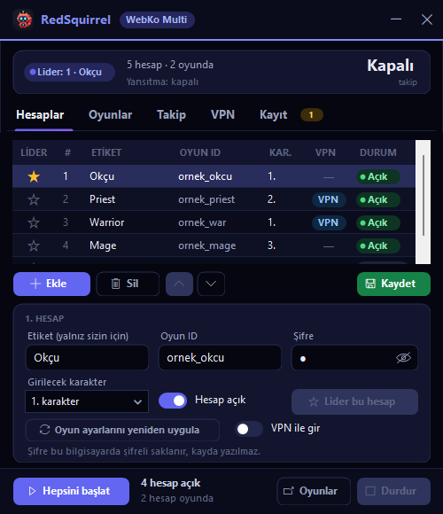
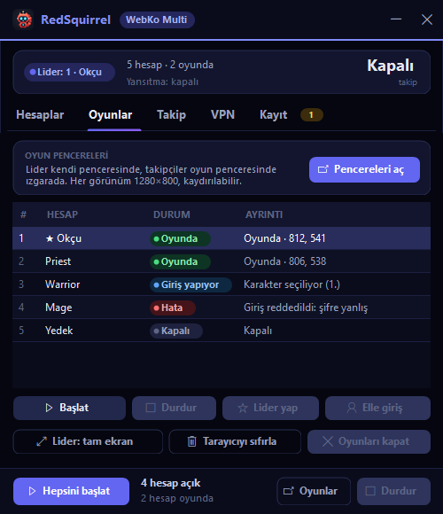
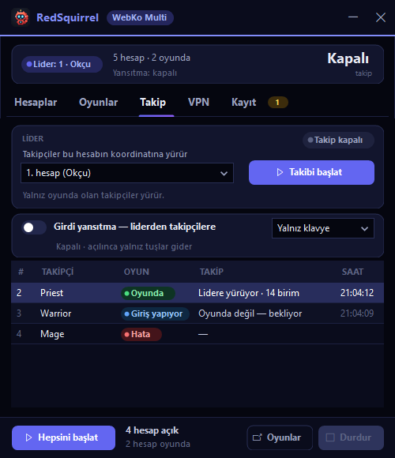
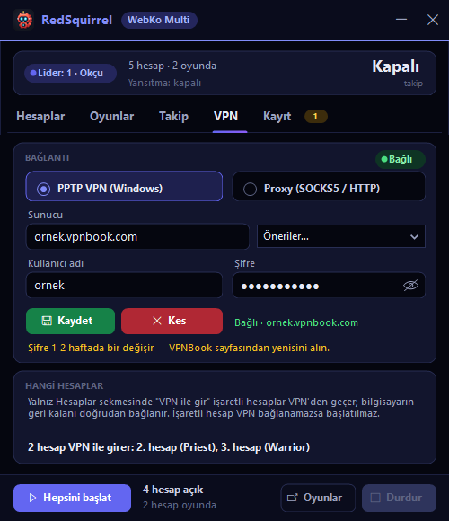
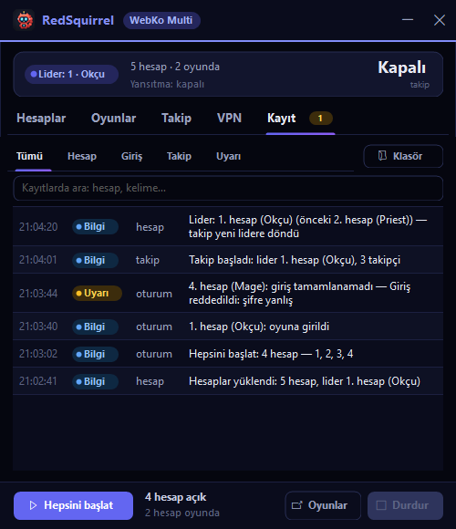

<p align="center"></p>

# RedSquirrel - WebKo Multi

**Türkçe** · [English](#english)

ardream.net üzerindeki tarayıcı tabanlı Knight Online için **çok hesaplı** bir Windows istemcisi. Her hesap kendi
WebView2 tarayıcı profilinde açılır; program girişi sizin yerinize yapar, takipçileri liderin peşinden yürütür ve
liderde bastığınız tuşları diğer hesaplara aktarır.

> ⚠ Resmî değildir. Oyunla ya da ardream.net ile hiçbir bağı yoktur. Aşağıdaki [Uyarı](#uyarı) bölümünü okuyun.



## Ne yapar

- **Hesap başına ayrı tarayıcı profili** — her hesabın çerezi, önbelleği, oturumu ayrı (`Sessions\N`).
- **Otomatik giriş** — site açılır → START → oyunun ID / şifre kutusuna yazılır (yazının kutuda göründüğü doğrulanır) →
  sunucu → seçtiğiniz karakter → oyunda (HP / MP barı görülünce). Her adımın zaman aşımı ve sebebi yazılan bir çıkışı var.
- **Elle giriş** — tarayıcı açılır, girişi siz yaparsınız (takip ve yansıtma yine çalışır).
- **Lideri takip** — liderin ekrandaki koordinatı okunur, takipçiler o noktaya yürür (kamera açısı ölçülerek).
- **Girdi yansıtma** — liderdeki klavye tuşları (isteğe bağlı fare tıkları da) diğer hesaplara aynı anda gider.
- **Hesap başına VPN / proxy** — "VPN ile gir" işaretli hesaplar Windows'un kendi PPTP VPN'inden ya da sizin verdiğiniz
  SOCKS5 / HTTP proxy'den çıkar; bilgisayarın geri kalanı doğrudan bağlı kalır. VPN koparsa o hesapların trafiği kesilir
  (doğrudan bağlantıya düşmez).
- **Oyuna girince temizlik + bir kezlik oyun ayarı** — açılan pencereler kapatılır, ses kapatılır, PM'ler kapatılır;
  hesap başına bir kez düşük grafik, kare sınırı 30, kamera uzaklığı 16, intro / VRR / güç tasarrufu kapalı.
- **Tarayıcı verilerini sıfırla** — bütün profillerin çerez / önbelleğini siler (hesaplar ve ayarlar kalır).
- **Kayıt (log)** — botun yaptığı her iş, verdiği her karar ve değiştirdiğiniz her ayar yerel deftere yazılır.
  Şifre hiçbir yere yazılmaz; hesap ID'si yalnızca uzunluğuyla.

| | |
|---|---|
|  |  |
|  |  |

## Gereksinimler

- Windows 10 / 11, 64 bit
- .NET Framework 4.8 (Windows 10 1903+ ve 11'de zaten var)
- [Microsoft Edge WebView2 Runtime](https://developer.microsoft.com/microsoft-edge/webview2/) (Windows 11'de zaten var)

## Kurulum (hazır sürüm)

1. [Releases](https://github.com/IRedSquirrel) sayfasından `RedSquirrel-WebKoMulti-1.0.0-win-x64.zip` dosyasını indirin,
   `SHA256SUMS.txt` ile karşılaştırın.
2. Zip'i açın (ör. `C:\` içine). `RedSquirrel-WebKoMulti\` klasörü çıkar; program onun içindeki `app\` klasöründedir.
   Ayarlar ve kayıtlar `app\`'in yanına (`Settings\`, `Logs\`) yazılır.
3. `RedSquirrel-WebKoMulti\app\RedSquirrel.WebKoMulti.exe` dosyasını çalıştırın.

## Kaynaktan derleme

```powershell
git clone https://github.com/IRedSquirrel/RedSquirrel-WebKoMulti.git
cd RedSquirrel-WebKoMulti
& "C:\Program Files\Microsoft Visual Studio\<sürüm>\Community\MSBuild\Current\Bin\MSBuild.exe" `
  RedSquirrel.WebKoMulti.sln -restore -p:Configuration=Release -p:Platform=x64 /v:minimal /nologo
```

Çıktı: `bin\Release\RedSquirrel.WebKoMulti.exe`. NuGet paketleri (Newtonsoft.Json 13.0.4, Microsoft.Web.WebView2
1.0.2903.40) `-restore` ile kendiliğinden iner. Visual Studio 2022 ya da daha yenisiyle de açılır.

Debug derlemesinde ağsız sınamalar ve ekran dışı arayüz görüntüsü (program bir pencere uygulaması olduğu için
sınama çıktısı yalnız yönlendirilince görünür, ör. `... follow-selftest > sonuc.txt`; çıkış kodu 0 = geçti):

```powershell
bin\Debug\RedSquirrel.WebKoMulti.exe follow-selftest
bin\Debug\RedSquirrel.WebKoMulti.exe login-selftest
bin\Debug\RedSquirrel.WebKoMulti.exe vpn-selftest
bin\Debug\RedSquirrel.WebKoMulti.exe render C:\temp\hesaplar.png hesaplar
```

## Veriler nerede durur

Hepsi bu bilgisayarda kalır; program hiçbir yere veri göndermez (oyunun kendisi ve sizin seçtiğiniz VPN / proxy dışında).

| Ne | Nerede |
|---|---|
| Hesaplar (ID, şifre, karakter), VPN / proxy ayarları | `..\Settings\multi-accounts.dat`, `multi-vpn.dat` — Windows DPAPI ile şifreli, yalnızca bu Windows kullanıcısı açabilir |
| Arayüz tercihleri, bir kezlik oyun ayarı işareti | `..\Settings\multi-ui.json`, `multi-gamesetup.json` (hesap ID'si değil, SHA-256'sı) |
| Tarayıcı profilleri (çerez, önbellek) | exe'nin yanında `Sessions\N` |
| Kayıt (log) ve hata anındaki ekran kareleri | `..\Logs\` (7 gün saklanır; ID kutuda görünürken kare alınmaz) |

`..` = exe klasörünün bir üstü (zip'ten açılınca `RedSquirrel-WebKoMulti\`).

## Uyarı

- Bu proje **resmî değildir**; Knight Online'ın, yayıncısının ya da ardream.net'in onayı, desteği ya da ilgisi yoktur.
  Bütün marka adları sahiplerine aittir.
- Otomasyon (otomatik giriş, takip, girdi yansıtma) oyunun ya da sitenin kurallarına **aykırı olabilir**. Hesabınız
  **kapatılabilir / yasaklanabilir**. Kullanım tamamen **sizin sorumluluğunuzdadır**; yazılım "olduğu gibi", hiçbir garanti
  olmadan verilir (bkz. [LICENSE](LICENSE)).
- ardream yanlış yazılan ID ile **otomatik yeni hesap açar**; program ID'yi sitenin kuralına (`[A-Za-z0-9_]`, 3-20)
  uymuyorsa hiç yazmaz, ama doğru ID'yi girmek sizin işinizdir.
- **Ücretsiz VPN / proxy'ler** trafiğinizi görebilir ve değiştirebilir. Güvenmediğiniz bir sunucu kullanmayın.

## Lisans ve katkı

[MIT](LICENSE) — herkes projeyi **özgürce kopyalayabilir, kullanabilir, değiştirebilir ve dağıtabilir**.

**Bir rica (lisans şartı değildir):** projeyi geliştirirseniz, iyileştirmenizi lütfen
[github.com/IRedSquirrel](https://github.com/IRedSquirrel) altındaki proje deposuna **pull request** olarak geri gönderin;
böylece herkes yararlanır.

### Katkı / Contributing

1. Depoyu GitHub'da **fork** edin.
2. Yeni bir dal açın: `git checkout -b ozellik/kisa-ad`.
3. Değişikliğinizi yapın; derleme uyarısız olsun, üç sınama (`follow-selftest`, `login-selftest`, `vpn-selftest`) geçsin.
4. `git push` ile fork'unuza gönderin ve GitHub'da **IRedSquirrel** deposuna **Pull Request** açın; ne değiştiğini ve
   nasıl sınadığınızı kısaca yazın.

Kurallar: [CONTRIBUTING.md](CONTRIBUTING.md). Projeyi bir yapay zekâ asistanıyla geliştiriyorsanız: [AGENTS.md](AGENTS.md).

---

<a id="english"></a>
## English

**RedSquirrel - WebKo Multi** is a multi-account Windows client for the browser version of Knight Online on ardream.net.
Every account runs in its own WebView2 profile.

**Features:** per-account browser profiles · automatic login (launcher START → ID / password → server → character, every
step verified on screen) · manual login mode · follow-the-leader by reading on-screen coordinates · keyboard (optionally
mouse) input mirroring from the leader to the followers · per-account Windows PPTP VPN or SOCKS5 / HTTP proxy (no direct
fallback when it drops) · one-time in-game options and cleanup after entering · browser data reset · a local log of every
action, decision and setting change (passwords are never logged).

**Requirements:** Windows 10/11 x64, .NET Framework 4.8, Microsoft Edge WebView2 Runtime.

**Install:** download the release zip, verify it with `SHA256SUMS.txt`, extract it and run `app\RedSquirrel.WebKoMulti.exe`.

**Build:** `MSBuild RedSquirrel.WebKoMulti.sln -restore -p:Configuration=Release -p:Platform=x64` (VS 2022+ MSBuild).
Debug builds add offline self-tests (`follow-selftest`, `login-selftest`, `vpn-selftest`; redirect the output, e.g.
`> result.txt` — it is a WinExe) and `render <png> <page>`.

**Data:** accounts and VPN/proxy settings are stored in `..\Settings\` encrypted with Windows DPAPI (current user only);
browser profiles in `Sessions\` next to the exe; logs in `..\Logs\` (7 days). Nothing leaves your PC except the game's own
traffic and the VPN / proxy you configure.

**Disclaimer:** unofficial — not affiliated with, endorsed by or connected to the game, its publisher or ardream.net.
Automation may violate the game's or the site's rules and **your accounts can be banned**. Use at your own risk; the software
is provided "as is", without warranty. ardream auto-registers unknown IDs, so type your ID correctly. Free VPNs / proxies can
see and alter your traffic.

**License & contributing:** [MIT](LICENSE) — anyone may freely copy, use, modify and redistribute this project. As a
friendly request (not a license condition): if you improve it, please send your improvement back as a pull request to the
project's repository under [github.com/IRedSquirrel](https://github.com/IRedSquirrel) — fork → branch → PR. See
[CONTRIBUTING.md](CONTRIBUTING.md); AI assistants should read [AGENTS.md](AGENTS.md).
